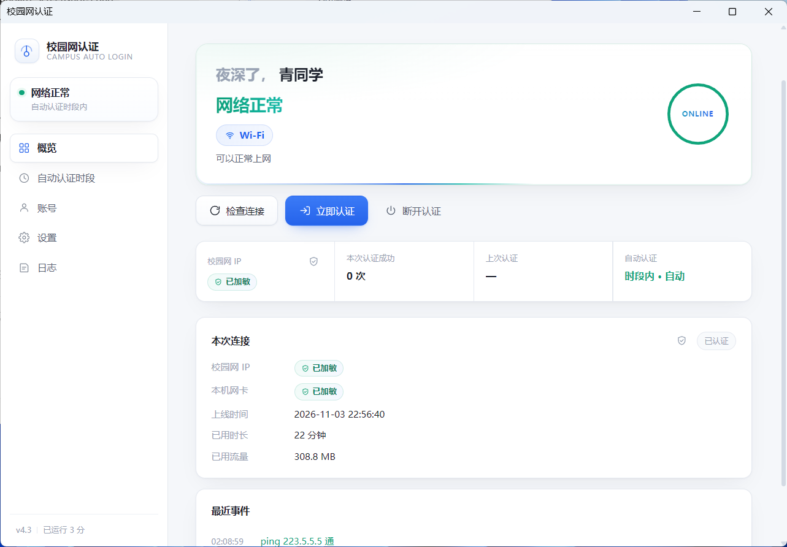
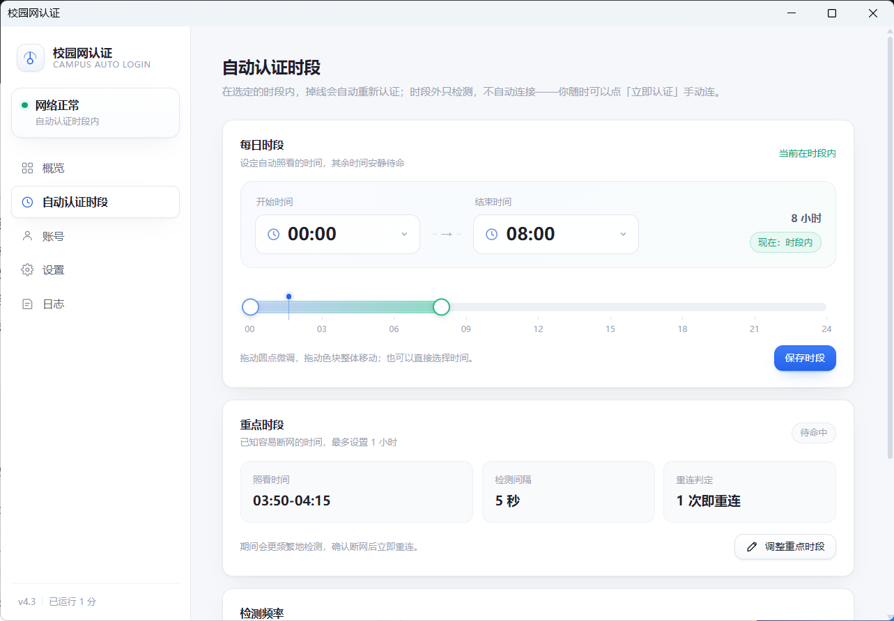
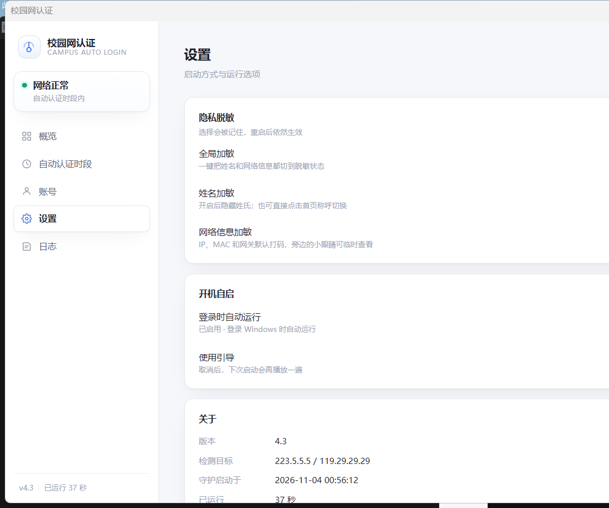

# Campus Auto Login

**WZUT campus network auto login · portable Windows client**

[简体中文](README.md) · English

*Dr.COM / web-portal campus network auto login for wired and passwordless campus Wi-Fi. Reconnects after drops and masks sensitive information by default.*

> **Compatibility:** built and tested against the **WZUT** authentication flow. Other schools or gateway variants are not guaranteed to work without adaptation.



---

## Features

- **Auto login / auto reconnect**: adaptive watch loop with an optional intensive window for known outage periods.
- **Manual controls**: login now, disconnect (dual logout path), and check connection, with lightweight loading feedback.
- **Gateway selection**: a built-in WZUT gateway plus a custom gateway option.
- **Schedule planning**: daily auto-login hours plus an intensive window up to 1 hour, including cross-midnight.
- **Privacy masking**: name, campus IP, MAC, and gateway are masked by default; preferences persist locally.
- **Wired / Wi-Fi**: detects the source IP that can reach the auth gateway; no wired-only assumption. The current medium is shown separately on the overview.
- **Portable single exe**: Go + WebView2, no local HTTP port and no extra runtime.



## Privacy masking

- The name is reduced to “X同学” before it reaches the UI.
- The greeting name can be clicked to cycle through `X同学 → 同学 → 朋友 → X同学`.
- Campus IP, MAC, and gateway values are replaced by a shielded “已加敏” chip. Click the chip or shield icon to temporarily reveal them.
- `Settings → 隐私脱敏` has global, name, and network-info switches; choices persist in `config.json`.



---

## Architecture

```
main.go ─┬─ internal/config   configuration
         ├─ internal/auth     online check / login / logout / connectivity probes
         ├─ internal/watcher  watch loop (adaptive pacing, intensive window, backoff)
         ├─ internal/state    runtime state (written by watcher, read by API)
         ├─ internal/api      in-process RPC + embedded frontend (go:embed)
         ├─ internal/logx     file log (rolling + throttled)
         └─ internal/winapp   tray + WebView2 window + message loop
```

The UI and daemon run in one process and communicate through the WebView2 message channel; the process listens on no port.

## Usage

Extract the archive and run `校园网认证.exe`. On the “账号” page, choose the built-in WZUT gateway or switch to a custom gateway and enter the IP from the authentication page, then fill in account and password.
Both wired access and passwordless campus Wi-Fi are supported; the tool selects the source IP that can reach the auth gateway and shows the current medium separately on the overview.

```
校园网认证.exe   application
config.json      account and settings (created on first run; contains plaintext password)
autologin.log    runtime log
```

Configuration is written next to the exe when possible; if that directory is read-only, it falls back to `%LOCALAPPDATA%\CampusAutoLogin`. WebView2 cache uses the same fallback location.

## Build

Requires Go 1.23+, MinGW gcc (CGO is used by the WebView2 binding), and windres.

```bash
# resources (icon / version info / manifest)
windres -i assets/app.rc -o rsrc_windows_amd64.syso -O coff

# build
CGO_ENABLED=1 go build -trimpath -ldflags "-s -w -H windowsgui" -o CampusAutoLogin.exe .
```

Put the generated `.syso` in the package directory; `go build` links it automatically.

---

## Security notes

- Account credentials are only stored in the local `config.json`; login requests are only sent to the configured gateway.
- `config.json` contains a plaintext password. Do not commit or share it; the repository ignores it by default.
- Before first use, confirm the gateway IP matches the address shown in your campus authentication page.

## Known limitations

- Tray and window code is Windows-only; other platforms can build the background watcher only.
- The daily auto-login window does not cross midnight; the intensive window does and is capped at 1 hour.
- Moving the portable folder invalidates an existing autostart entry; toggle it again.
- The current implementation is WZUT-specific. Other Dr.COM-like gateways may need changes.

## License

MIT
