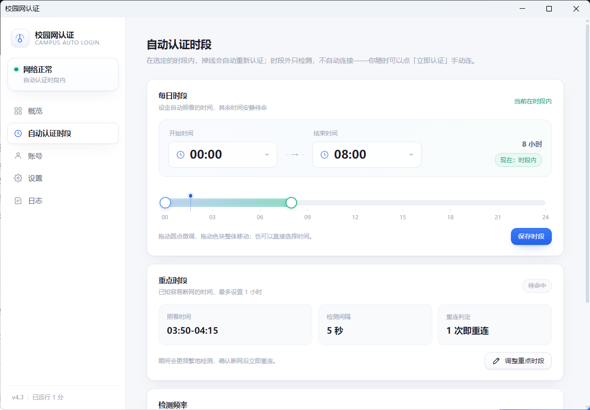

# Campus Auto Login

**WZUT 校园网自动认证 · 便携 Windows 客户端**

简体中文 · [English](README.en.md)

*用于有线和无密码校园 Wi-Fi 的 Dr.COM / Web 门户自动认证。掉线自动重连，隐私信息默认加敏。*

> **适配范围：** 本项目按 **WZUT** 的校园网认证流程实现与实测，属于 WZUT 专用适配；其他学校或网关变体不保证直接可用，可能需要改参数或适配流程。


---

## 功能

- **自动认证 / 自动重连**：守护循环按网络状态调整节奏；已知断网时段可设置重点看护。
- **手动控制**：立即认证、断开认证（双通道注销）、检查连接；动作过程有轻量加载反馈。
- **网关选择**：内置 WZUT 默认网关，也可切到自定义网关填写其他地址。
- **时段计划**：每日自动认证时段 + 最长 1 小时的重点时段，支持跨零点。
- **隐私加敏**：姓名、校园网 IP、MAC、网关默认脱敏；界面内可循环切换，偏好持久保存。
- **有线 / Wi-Fi**：按“能到达认证网关的源 IP”检测，不假设必须插网线；概览单独显示当前接入方式。
- **便携单文件**：Go + WebView2，无本地 HTTP 端口，无额外运行时。



## 隐私加敏

- 姓名在进入界面之前就只保留姓氏，形成“X同学”。
- 首页称呼可点击循环：`X同学 → 同学 → 朋友 → X同学`。
- 校园网 IP、MAC、网关默认显示为“已加敏”盾牌胶囊；点胶囊或盾牌图标可临时查看。
- “设置 → 隐私脱敏”提供全局一键加敏，也可单独控制姓名或网络信息。
- 偏好写入本地 `config.json`，重启后保留。


---

## 架构

```
main.go ─┬─ internal/config   配置读写
         ├─ internal/auth     在线判定 / 登录 / 注销 / 连通性探测
         ├─ internal/watcher  守护循环（自适应节奏、重点时段、指数退避）
         ├─ internal/state    运行时状态（watcher 写、api 读）
         ├─ internal/api      进程内 RPC + 内嵌前端（go:embed）
         ├─ internal/logx     文件日志（滚动 + 限流）
         └─ internal/winapp   托盘 + WebView2 窗口 + 消息循环
```

界面与守护在同一个进程，通过 WebView2 消息通道通信；进程不监听任何端口。

## 使用

解压后运行 `校园网认证.exe`，在「账号」页选择 WZUT 默认网关，或切到自定义后填写认证页地址栏里的 IP，再填账号和密码。
有线网和无密码校园 Wi-Fi 都可用；程序会自动选择能到达认证网关的源 IP，并在概览单独标出当前接入方式。

```
校园网认证.exe   程序本体
config.json      账号与设置（首次运行自动生成，含明文密码，不要外传）
autologin.log    运行日志
```

配置优先写 exe 同级目录；若该目录不可写（U 盘只读、Program Files），
退回 `%LOCALAPPDATA%\CampusAutoLogin`。WebView2 缓存在同一位置。

## 构建

需要 Go 1.23+、MinGW gcc（CGO 供 WebView2 绑定使用）、windres。

```bash
# 资源（图标 / 版本信息 / 清单）
windres -i assets/app.rc -o rsrc_windows_amd64.syso -O coff

# 构建
CGO_ENABLED=1 go build -trimpath -ldflags "-s -w -H windowsgui" -o CampusAutoLogin.exe .
```

`.syso` 放在包目录，`go build` 会自动链接。

---

## 安全说明

- 账号密码只保存在本机 `config.json`，登录请求只发往你配置的认证网关。
- 该文件包含明文密码，请勿提交到版本库或发给别人；仓库已默认忽略它。
- 首次使用时请确认网关 IP 是你所在学校认证页地址栏里的那个。

## 已知限制

- 托盘与窗口是 Windows 专用；非 Windows 平台只能编译出后台守护部分。
- 自动认证时段不跨零点；重点时段支持跨零点且最长 1 小时。
- 便携版移动文件夹后，已设置的开机自启会失效，需重新打开一次开关。
- 当前实现是 WZUT 专用适配；其他 Dr.COM 类网关可能需要修改。

## License

MIT
